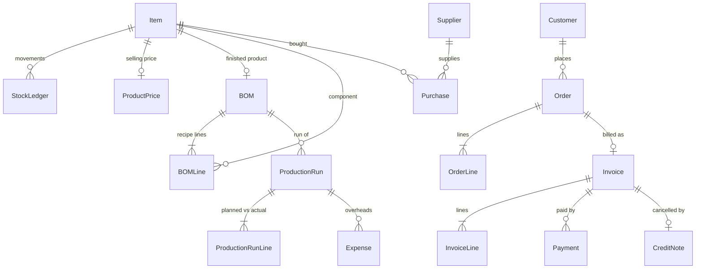

# Design Note: Order-to-Audit System

One Django application, one SQLite database. Every transaction is entered once, at its source, and flows into stock, production, costing and accounts through a single services layer (`core/services.py`). Screens only call these tested functions.

## 1. Data model

- **Item** covers raw materials, packaging and finished goods (`kind`), each with one `base_unit` (g, ml or pcs). One table means one ledger for every stock number.
- **StockLedger** records every movement (`quantity`, `value_paise`, `movement_type`) with `source_type` and `source_id` pointing to the Purchase, ProductionRun, Invoice or CreditNote that caused it.
- **AuditLog** (user, action, model, object id, details, time) is written for every state-changing action.
- Customer details are copied onto the invoice when it is issued, so old invoices never change.

## 2. Money and quantities

- Money is stored as **integer paise**, and quantities as **integers in base units** (40 kg = 40,000 g, 10.5 L = 10,500 ml). There are no floats anywhere.
- Unit conversion (`to_base`) uses `Decimal` and rejects anything that is not a whole number of base units. Forms show kg, litres and pieces, and values are converted on the way in.
- All divisions use `Decimal` with ROUND_HALF_UP.

## 3. How stock is computed

- `StockLedger` is **append-only**: `save()` on an existing row and `delete()` both raise errors, and the admin pages are read-only.
- **Balance = sum of `quantity`** for the item. Opening balance + receipts - issues ± adjustments is therefore always true by construction.

| Event | Ledger rows written |
|---|---|
| Opening stock | OPENING, + each item |
| Purchase | PURCHASE, + raw or packaging item, with its value |
| Production run | PROD_ISSUE, - each BOM item; PROD_OUTPUT, + finished item |
| Dispatch | DISPATCH, - finished item, valued at weighted-average cost |
| Invoice cancelled | SALE_RETURN, + exactly reversing the dispatch rows |

- Each action runs in one `transaction.atomic`, so a failure leaves nothing behind. Dispatch re-checks stock because two approved orders can compete for the same packets.

## 4. How BOM consumption works

- A **BOM** stores, per finished product, the standard quantity of each component per batch and the expected yield (Murukku 200 g: 200 packets; flour 40 kg, oil 10 L, spice 1.2 kg, pouches 200, cartons 10).
- A **production run** records the **actual** quantity issued or used per BOM line, the wastage part of it, and the actual good output.
- Expected output = yield × batches. Standard per line = BOM quantity × batches.
- **Variance (basis points)** = (actual - standard) × 10,000 ÷ standard. A line or the yield is flagged when |variance| is **strictly greater** than the tolerance (3% = 300 bp, configurable).
- Benchmark: yield 188 vs 200 = -600 bp (flagged); oil 10,500 vs 10,000 ml = +500 bp (flagged); pouches 194 vs 200 = -300 bp (not flagged, because 300 is not greater than 300); cartons 9 vs 10 = -1,000 bp (flagged).
- Flour, oil and spice are consumed at the quantity **issued**; pouches and cartons at the quantity **actually used** (194 = 188 good + 6 damaged).
- If any item is short, the whole run is rejected and nothing is written.

## 5. Costing and valuation

- **Method: moving weighted average**, chosen because it is simple, standard for food manufacturing and easy to audit. Issue value = quantity × (total ledger value ÷ total ledger quantity).
- Flour: 100 kg × Rs 42 + 60 kg × Rs 45 = Rs 6,900 for 160 kg, i.e. Rs 43.125/kg, so 40 kg costs Rs 1,725.
- Run material cost = Rs 4,055 (flour 1,725; oil 1,470; spice 240; pouches 485; cartons 135).
- **Overhead rule:** labour and gas/power are recorded against the production run and absorbed fully by that run's good packets.
- **Cost per packet** = (material + overhead) ÷ good packets = 585,500 paise ÷ 188 = 3,114 paise, **Rs 31.14**. Dividing by good packets, not the planned 200, makes yield loss visible in the cost.
- Margin against the Rs 50 selling price: Rs 18.86 per packet, 37.72%.
- The opening 50 finished packets carry no value because the brief gives no cost for them.

## 6. Sales, GST and audit

- **Flow:** order → admin verifies (stock check shown; approval blocked if short) → GST invoice → dispatch → payments.
- **GST:** per line, in paise. If the customer's state code equals the factory's (33), CGST + SGST at half the rate each; otherwise IGST. Retailer A: Rs 7,500 + 187.50 + 187.50 = Rs 7,875.
- **Invoice numbers** restart each financial year: `INV/2026-27/0001`.
- **Cancellation** is by credit note (`CN/2026-27/0001`), never deletion, and it reverses the stock rows. An invoice with payments cannot be cancelled.
- **Audit:** edits to lines, approvals, invoices, dispatches, payments, runs and expenses are logged with user and time, inside the same transaction as the action.
- **Access:** five roles (salesman, admin, production, accountant, owner) enforced by permission checks on every view.