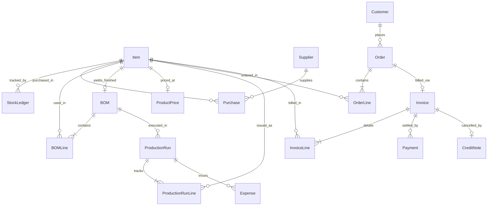

# Order-to-Audit System: Technical Design Note

## 1. Relational Schema & Entity-Relationship Architecture

The data architecture is structured to maintain strict relational integrity, immutable financial accounting, and append-only inventory auditing.



### Table Directory
* `core_item`: Inventory master catalog (Raw materials, Packaging, Finished goods; Base units: `g`, `ml`, `pcs`).
* `core_stockledger`: Append-only immutable ledger tracking all stock quantities and valuation movements.
* `core_supplier`: Vendor registry with GST identification numbers (GSTIN).
* `core_purchase`: Inward purchase receipts linking supplier, material, quantity, and value.
* `core_bom`: Bill of Materials header mapping finished goods to expected batch yields.
* `core_bomline`: Standard component quantities required per production batch.
* `core_productionrun`: Batch execution records tracking actual vs expected output and yield variances.
* `core_productionrunline`: Actual material issues, scrap/wastage, variance in basis points, and flags.
* `core_expense`: Direct operational overheads (Labour, Gas/Power, Other) attached to runs.
* `core_customer`: Retailer and distributor client profiles with GSTIN and state codes.
* `core_productprice`: Catalog selling prices, GST tax rates (in basis points), and HSN codes.
* `core_order`: Sales orders submitted by field representatives and approved by administration.
* `core_orderline`: Ordered finished goods quantities and negotiated unit selling prices.
* `core_invoice`: Legal GST tax invoices with financial year sequencing and intra/inter-state tax breakdowns.
* `core_invoiceline`: Itemized invoice rows detailing taxable amounts, CGST, SGST, and IGST.
* `core_payment`: Customer remittances linked to issued invoices (Cash, UPI, Bank, Cheque).
* `core_creditnote`: Credit notes generated to cancel issued invoices and trigger stock reversals.
* `core_auditlog`: Append-only event log capturing critical state mutations across business models.

---

## 2. Stock Computation & Ledger Immutability

Inventory is tracked via an append-only ledger (`StockLedger`) adhering to double-entry principles:
1. **No In-Place Overwrites:** Inventory balances are never stored as mutable scalar columns on the item record. Stock balance is derived dynamically:
   $$\text{Stock Balance} = \sum \text{StockLedger.quantity} \quad (\text{for a given } \text{item\_id})$$
   $$\text{Total Stock Value} = \sum \text{StockLedger.value\_paise} \quad (\text{for a given } \text{item\_id})$$
2. **Traceability:** Every row records `source_type` (e.g., `Purchase`, `ProductionRun`, `Invoice`, `CreditNote`) and `source_id`, providing an unbroken audit trail back to the originating business transaction.
3. **Application Immutability:** Overridden `save()` and `delete()` methods on `StockLedger` raise a `RuntimeError` if an update or delete operation is attempted on an existing primary key.
4. **Movement Types:** Seven strict categories: `OPENING`, `PURCHASE`, `PROD_ISSUE`, `PROD_OUTPUT`, `DISPATCH`, `ADJUSTMENT`, and `SALE_RETURN`.

---

## 3. BOM Consumption & Variance Mechanics

1. **Standard Requirement:** For a production run of $B$ batches, the standard recipe requirement for component $i$ is:
   $$\text{standard\_qty}_i = \text{bom\_line.quantity}_i \times B$$
2. **Actual Consumption:**
   * Raw materials (Flour, Oil, Spices) are consumed based on the **actual quantity issued** into the batch.
   * Packaging materials (Pouches, Cartons) are consumed based on **actual usage**:
     $$\text{issued\_pouches} = \text{actual\_good\_packets} + \text{damaged\_pouches (wastage)}$$
3. **Variance Formula:** Calculated in integer basis points ($1\% = 100\text{ bp}$) using `ROUND_HALF_UP`:
   $$\text{variance\_bp} = \text{round}\left( \frac{(\text{actual\_qty} - \text{standard\_qty}) \times 10{,}000}{\text{standard\_qty}} \right)$$
4. **Tolerance Flagging:** Flagged if and only if absolute variance is **strictly greater** than the configured tolerance (default $3.00\% = 300\text{ bp}$):
   $$\text{is\_flagged} = |\text{variance\_bp}| > \text{tolerance\_bp}$$
   * *Boundary Case:* A variance of exactly $-3.00\%$ ($-300\text{ bp}$), such as the benchmark pouch consumption, evaluates to $|-300| > 300 \implies \text{False}$ and is **not flagged**.

---

## 4. Costing, Valuation & Margin Rules

### Rationale for Weighted-Average Costing
Food manufacturing ingredients fluctuate in price across vendor shipments. Moving weighted-average costing prevents artificial profit volatility caused by lot-specific price swings, eliminates complex batch-level inventory tracking required by strict FIFO, and ensures materials issued into production reflect true contemporary replacement costs.

### Cost and Margin Formulas
* **Stock Issue Valuation:**
  $$\text{issue\_cost\_paise} = \text{round}\left( \frac{\text{issue\_qty} \times \text{get\_value(item)}}{\text{get\_balance(item)}} \right)$$
* **Overhead Allocation Rule:** Direct overhead expenses (`LABOUR`, `GAS_POWER`, `OTHER`) attach directly to the specific production run where they were consumed. Costs are absorbed exclusively by good units:
  $$\text{cost\_per\_packet\_paise} = \text{round}\left( \frac{\text{material\_cost\_paise} + \text{overhead\_paise}}{\text{actual\_good\_packets}} \right)$$
* **Gross Margin:**
  $$\text{margin\_bp} = \text{round}\left( \frac{(\text{selling\_price\_paise} - \text{cost\_per\_packet\_paise}) \times 10{,}000}{\text{selling\_price\_paise}} \right)$$

### Benchmark Worked Example
```text
1. Flour Weighted Average Cost:
   Opening (100 kg @ Rs 42) + Purchase (60 kg @ Rs 45) = 160 kg @ 690,000 paise
   Weighted Rate = 690,000 / 160 = 4,312.5 paise/kg (Rs 43.125 / kg)

2. Production Run Cost (188 good packets):
   - Flour (40 kg):                      172,500 paise (Rs 1,725.00)
   - Cooking Oil (10.5 L @ Rs 140/L):    147,000 paise (Rs 1,470.00)
   - Salt & Spice (1.2 kg @ Rs 200/kg):   24,000 paise   (Rs 240.00)
   - 200 g Pouches (194 pcs @ Rs 2.50):   48,500 paise   (Rs 485.00)
   - Cartons (9 pcs @ Rs 15.00):          13,500 paise   (Rs 135.00)
   -----------------------------------------------------------------
   Total Material Cost:                  405,500 paise (Rs 4,055.00)
   + Overheads (Labour 1200 + Gas 600):  180,000 paise (Rs 1,800.00)
   -----------------------------------------------------------------
   Total Run Cost:                       585,500 paise (Rs 5,855.00)

3. Unit Cost & Profit Margin:
   Cost per Packet = 585,500 / 188 = 3,114.36 paise -> 3,114 paise (Rs 31.14)
   Selling Price   = Rs 50.00 (5,000 paise)
   Unit Margin     = 5,000 - 3,114 = 1,886 paise (Rs 18.86)
   Gross Margin %  = (1,886 * 10,000) / 5,000 = 3,772 bp (37.72%)
```

---

## 5. Audit Trail & Document Invariance

1. **Transactional Integrity:** Every high-impact event (`ORDER_APPROVED`, `INVOICE_CREATED`, `DISPATCH_RECORDED`, `PAYMENT_RECORDED`, `INVOICE_CANCELLED`) writes an entry to `core_auditlog` inside the exact same `transaction.atomic()` database block as the underlying business action.
2. **Immutable Invoicing via Credit Notes:** Once an invoice is generated, it cannot be modified or deleted. To nullify an erroneous unpaid invoice:
   * A sequential `CreditNote` is issued (`CN/YYYY-YY/####`).
   * Any inventory dispatches tied to the invoice are reversed by appending `SALE_RETURN` entries into `StockLedger`.
   * Invoices with recorded customer payments are strictly barred from cancellation.

---

## 6. Role-Based Permissions Matrix

| Action / Capability | Salesman | Admin | Production | Accountant | Owner |
|---|:---:|:---:|:---:|:---:|:---:|
| `place_order` / `view_own_orders` | **Yes** | No | No | No | No |
| `view_all_orders` | No | **Yes** | No | **Yes** | **Yes** |
| `edit_order` / `approve_order` / `reject_order` | No | **Yes** | No | No | No |
| `create_invoice` / `record_dispatch` | No | **Yes** | No | No | No |
| `record_payment` / `cancel_invoice` | No | **Yes** | No | No | No |
| `record_purchase` / `record_production_run` / `record_expense` | No | No | **Yes** | No | No |
| `view_stock` / `view_costing` | No | **Yes** | **Yes** | **Yes** | **Yes** |
| `view_reports` (Full CSV Export Suite) | No | No | No | **Yes** | **Yes** |
| `download_invoice_pdf` | No | **Yes** | No | **Yes** | **Yes** |
| `view_dashboard` | No | No | No | No | **Yes** *(Unimplemented)* |

* **Read-Only Separation:** Accountant and Owner roles have zero overlap with state-changing actions, safeguarding financial and operational reporting from tampering.
